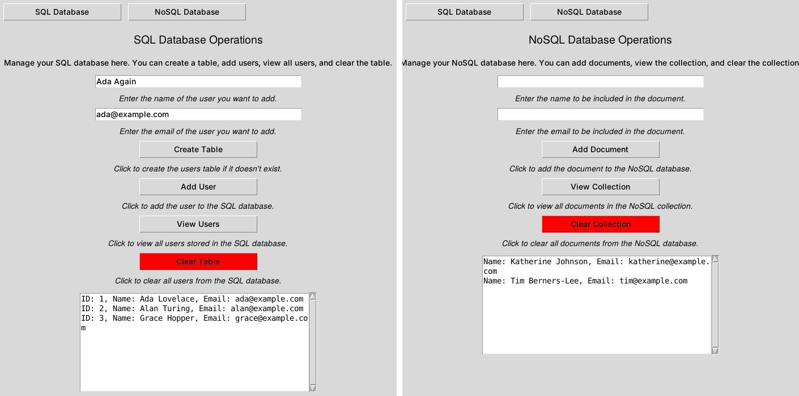

# Cloud-Based Data Management System

[](https://github.com/mcneillium/CloudBasedDataManagementSystem/actions/workflows/tests.yml)

The same small "users" dataset managed two ways: in a relational database
(SQLite) and in a document database (MongoDB, local or Atlas), with a Tkinter
GUI to insert and list records in each.

Case study: [paulmartinmcneill.com/projects/cloud-data-management](https://paulmartinmcneill.com/projects/cloud-data-management/)



## What it shows

- **SQL (`sql/sql_db.py`):** a `users` table with a unique email constraint;
  inserting a duplicate email is refused and reported.
- **NoSQL (`nosql/nosql_db.py`):** a `users` collection in MongoDB; insert,
  list and clear documents. MongoDB has no table schema, so the same
  one-account-per-email rule comes from a unique index on `email`.
- **Both refuse duplicates the same way:** the GUI reports a refused email
  instead of claiming success.
- **Configuration:** the MongoDB connection string is read from the
  `MONGO_URI` environment variable (or a local `.env` file), never from code.
- **Tests:** the SQL manager is tested against an in-memory SQLite database
  and the NoSQL manager against `mongomock`, so the tests need no database
  server. They run on every push.

## Run it

You need [uv](https://docs.astral.sh/uv/), which fetches the right Python (3.13
or later, with Tkinter included) and every dependency from the lock file.

```bash
git clone https://github.com/mcneillium/CloudBasedDataManagementSystem.git
cd CloudBasedDataManagementSystem
cp .env.example .env       # then put your own MongoDB connection string in .env
uv run main_gui.py         # opens the GUI
uv run pytest              # runs the tests (no database server needed)
uv run mypy                # checks the types
```

## Changes (November 2026)

- Adding a user whose email was already taken used to show "added
  successfully" while the database had refused it. The GUI now reports it.
- The MongoDB collection now refuses duplicate emails too (unique index), so
  the two stores follow the same rule. A test covers it.
- Adding a SQL user no longer fails if "Create Table" hasn't been clicked first.

### Second round (November 2026): current tooling

- Both database managers are **typed** and checked by mypy in strict mode.
- **uv** manages Python and the dependencies from one `pyproject.toml` and a
  lock file, replacing the two requirements files. **Ruff** lints and formats.
- The tests, type check and lint run on **Python 3.13, 3.14 and 3.15** on
  every push. Dependabot proposes updates once a month.

## Licence

MIT, see [LICENSE](LICENSE).
